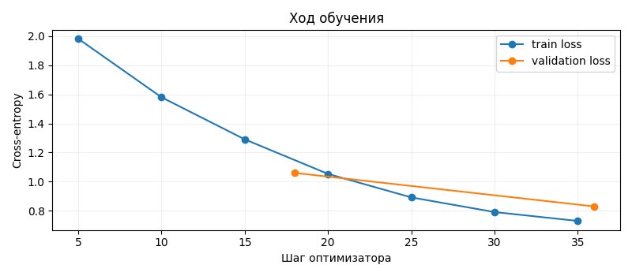
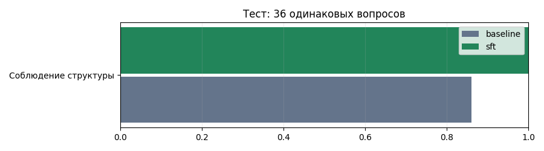

# Домашние растения: дообучение и оценка Qwen2.5

**Итоговый отчёт · 5 ноября 2026 года · эксперимент 0e734bee13c1**

## 1. Задача, гипотеза и первые ответы

Разработан русскоязычный текстовый помощник по уходу за домашними растениями. Вопрос содержит вид, условия или симптом; ответ должен давать понятный порядок действий и обозначать недостающие сведения. Темы: полив, свет, пересадка, питание, размножение и типичные проблемы. Фотографии, RAG и пользовательский интерфейс в этот этап не входят.

Гипотеза: SFT на тематическом наборе улучшит соблюдение структуры и полезность ответов. Базовая модель — **Qwen/Qwen2.5-3B-Instruct**, отдельный судья — Qwen2.5-7B-Instruct. До и после применены один системный промпт, 4-битное NF4-квантование и greedy decoding с лимитом 384 токена. Опорные факты из test доступны только оценщику.

**Что получилось.** Проведены первые генерации, пробное и основное обучение на T4, загрузка адаптера, автоматическая и модельная оценка до/после. Соблюдение формата на 36 вопросах выросло с 31 до 36 ответов. При этом содержательные ошибки сохранились, а в оценках судьи найдены приписанные ответам утверждения. Гипотеза подтверждена для структуры на этом тесте; общего улучшения предметной полезности доказать не удалось.

### Первый прогон до обучения

Вопросы взяты из validation. Полные сообщения и ответы сохранены в `results/experiment/baseline_validation.jsonl`.

| Вопрос | Наблюдение по исходному ответу |
| --- | --- |
| Монстера: сверху сухо, глубже сыро. Уже поливать? | Предложен полив по сухому верхнему слою и странная проверка «глубины впитывания». Влага глубже учтена плохо. Формат соблюдён. |
| Сансевиерия: прихожая без окна и лампы. Допустимо? | Рекомендована досветка, но добавлено опрыскивание без основания. Заголовок «Краткие рекомендации» нарушил заданный формат. |

Эти случаи показывают различие структуры и содержания: первый ответ проходит формальную проверку, но не становится от этого предметно правильным. Первый judge-прогон дал обоим ответам корректность 3/5 и полезность 5/5 — уже на пилоте заметна мягкость оценки полезности.

<!-- PAGEBREAK -->

## 2. Данные и разбиение

Создан авторский синтетический набор: 12 растений × 12 типов задач = **144 исходные ситуации**. Профили и вопросы находятся в `data/profiles.json`; сборка — `python -m src.prepare_data`. Ответы составлены из кратких правил и видовых фактов с ссылками на NC State Extension, UC IPM, университетские справочники и RHS. Полные статьи и изображения не копировались. Происхождение записей явно указано: `assistant_authored_rule_composition`.

| Часть | Строк | Исходных ситуаций | Назначение |
| --- | ---: | ---: | --- |
| Train | 288 | 96 | Обучение; по 3 формулировки вопроса |
| Validation | 12 | 12 | Контроль и выбор checkpoint |
| Test | 36 | 36 | Финальное сравнение двух версий |

На каждое растение приходится 8 train-, 1 validation- и 3 test-ситуации. Темы сбалансированы: по 3 тестовых вопроса на тип задачи. Три train-формулировки не считаются независимыми примерами. Первоначальный ориентир на 1000 записей сокращён: дополнительные шаблонные строки увеличили бы объём, но не покрытие фактов.

В JSONL есть `id`, `group_id`, `plant`, `topic`, `messages`, `source_ids`, опорные факты и перечень существенных ошибок. Роли в `messages`: system, user, assistant. Все три файла загружены через `datasets.load_dataset("json", ...)`. Trainer читает только train/validation; генератор — только system/user.

### Пример обучающего материала

`monstera_light_v0`: «Хочу переставить молодую монстеру на южный подоконник без тюля. Как сделать это без ожогов?» Основные элементы ответа: постепенная адаптация, рассеянный свет, наблюдение за новыми повреждениями, уточнение длительности прямого солнца. Эталон оформлен тремя заданными разделами и списком действий; полностью доступен в JSONL.

### Проверки и ограничения

До обучения зафиксировано разбиение. Группы перефразировок не пересекаются; проверены уникальность id, точные дубли вопросов, роли, источники и структура эталонов. При символьной близости вопросов выше 0,82 совпадений между train и validation/test не найдено. Это ограниченная эвристика, а не доказательство отсутствия семантических повторов.

Общие шаблоны ответов и правила остаются во всех частях. Поэтому измеряется перенос между комбинациями растения и задачи внутри синтетического распределения. Набор не заменяет реальные обращения; независимой ботанической разметки нет. После просмотра test веса и настройки не менялись.

<!-- PAGEBREAK -->

## 3. Автоматическая проверка

Реализована `validate_format(answer)` в `src/checks.py`. Она требует:

1. По одному разделу «Краткий ответ», «Рекомендации», «Что уточнить», в указанном порядке.
2. Непустое содержимое разделов.
3. От двух до пяти непустых пунктов в рекомендациях.

Допускаются Markdown-заголовки и маркированные/нумерованные списки. Проверка возвращает результат и причины отказа. Это полезно для темы ухода: пользователю важно отделить вывод, действия и уточнения. Проверка не оценивает правильность советов, русский язык, грамматику или отсутствие лишних фраз.

### Проверенные срабатывания

| Случай | Ожидание | Фактически |
| --- | --- | --- |
| Корректные три раздела и два пункта | Пропуск | Пропуск |
| Те же разделы с Markdown | Пропуск | Пропуск |
| Пропущен раздел | Отказ | Отказ |
| Пустой раздел | Отказ | Отказ |
| Рекомендации абзацем без списка | Отказ | Отказ |
| Повтор заголовка | Отказ | Отказ |
| Неправильный порядок | Отказ | Отказ |

Все семь случаев выполнены; данные сохранены в `results/check_examples.json`. Дополнительно проверены пустые пункты, маски токенов, подсчёт метрик при пропусках, повторные оценки и упаковка артефактов. Всего локально прошли 15 проверок; отдельно — CPU-интеграция с маленькой случайной Qwen2. Она проверяла код, а не качество обученной 3B-модели.

### Пример реального отказа и метрика

В `ficus_drainage_v0` baseline использовал «Краткие рекомендации» вместо «Рекомендации»: проверка отказала. После SFT заголовок исправился. При этом обе версии советовали слить воду; исправление заголовка не доказывает улучшения самого совета.

Метрика: число прошедших ответов / число всех тестовых вопросов. Ошибка генерации остаётся в знаменателе. Получено **31/36 = 86,11% до** и **36/36 = 100% после**, прирост **13,89 процентного пункта**. Ошибок исполнения и обрезанных ответов нет.

Полнота структуры стала лучше на данном тесте. Но фразы вроде «мягкие твёрдые листья» проходят эту проверку: её область применения намеренно узкая.

<!-- PAGEBREAK -->

## 4. Модель-судья и протокол оценки

Судья — отдельная **Qwen2.5-7B-Instruct**, загруженная последовательно после освобождения GPU. API-ключ не нужен. Судья получает вопрос, ответ, опорные факты и типичные существенные ошибки. Версия отвечавшей модели скрыта, задания перемешаны с seed=42. Полный промпт — `prompts/judge.txt`; запросы, исходные ответы и ревизии сохранены в JSONL.

| Критерий | Что оценивается |
| --- | --- |
| Correctness | Соответствие фактам, отсутствие существенной ошибки |
| Usefulness | Понятные применимые действия |
| Context | Учёт условий и необходимой неопределённости |
| Consistency | Согласованность рекомендаций |

По каждому критерию используются целые баллы 1–5: 1 означает серьёзную проблему, 3 — частичное выполнение, 5 — отсутствие замеченной проблемы. Промежуточные 2 и 4 допустимы. Отдельно возвращаются `critical_error` и объяснение. Невалидный JSON можно исправить одной повторной попыткой; пропуски учитываются через покрытие.

### Выполненные вызовы

Пилот: два исходных validation-ответа до обучения. Затем — 24 validation-оценки суммарно и 72 основные test-оценки. Для шести test-заданий выполнен повтор с обратным порядком полей контекста. Все 102 сохранённых результата валидны с первой попытки; исходные JSON совпадают с распарсенными баллами. Покрытие test — 36/36 для обеих версий.

Повторная проверка не является независимым судейством. Среднее абсолютное изменение баллов при перестановке полей — **0,417** по четырём критериям и шести ответам. В двух заданиях числовые оценки изменились. Например, у `spider_specific_v0` корректность baseline упала с 5 до 3 при неизменном ответе.

### Как интерпретировать

Судья из того же семейства может иметь общее смещение с базой. Высокая полнота JSON не гарантирует правильной оценки. После запуска выполнен содержательный разбор всех 36 пар помощником, без независимого ботанического эксперта. Выявлена конкретная проблема: судья переносит некоторые примеры ошибок из справочного контекста в обвинения оцениваемому ответу. Подробности приведены в разделе 7.

Оценки не исправлялись задним числом: исходные числа сохранены и опубликованы как результат выбранного протокола вместе с обнаруженными ограничениями.

<!-- PAGEBREAK -->

## 5. Обучение на T4 и ход эксперимента

Подтверждённая среда: **Tesla T4**, 14,56 GiB памяти, Python 3.13.16, PyTorch 2.8.0, Transformers 4.56.2, PEFT 0.17.1, bitsandbytes 0.47.0. Базовая ревизия: `aa8e72537993ba99e69dfaafa59ed015b17504d1`; судья: `a09a35458c702b33eeacc393d103063234e8bc28`.

| Параметр | Значение |
| --- | --- |
| Метод | QLoRA, NF4 + double quantization, вычисления FP16 |
| LoRA | rank 16, alpha 32, dropout 0,05; 7 типов линейных слоёв |
| Batch / накопление | 1 / 16 |
| Learning rate / scheduler | 0,0001 / cosine; warmup 0,03 |
| Эпохи / шаги | 2 / 36 |
| Длина / seed | 1024 / 42 |
| Выбор checkpoint | Минимум validation loss; checkpoint-36 |

Использованы Transformers Trainer и явная маска: system/user исключены из loss, assistant и токен его завершения включены; padding имеет label=-100. Слишком длинные примеры не обрезаются молча. Реальный максимум train — 522 токена, медиана 465. Обучаемых токенов ответов в train — 53 322 на проход.

Перед длительным запуском выполнены два пробных шага и загрузка пробного адаптера новым процессом. Основное обучение заняло **13.92 мин**. Пик по `torch.cuda.max_memory_allocated` — **4.37 GiB**; это выделения PyTorch, а не полное потребление всей видеопамяти. Validation loss снизился с 1,061 после первой эпохи до 0,831 после второй.

Первый запуск прервался при скачивании судьи с `IncompleteRead / ChunkedEncodingError`. Повторный запуск использовал кэш и сохранённые этапы, затем прошёл весь pipeline. Добавлена подготовка загрузки с одним потоком и ограниченными сетевыми повторами. В сыром `state.json` осталась историческая ошибка, но итоговый статус — `computed`, все 15 стадий завершены.

<!-- PAGEBREAK -->

## 6. Количественные результаты

Обе версии отвечали на **одни и те же 36 test-вопросов**. Ни один ответ не потерян и не обрезан. Для всех получены валидные оценки, поэтому общий набор пар также равен 36. Метрики и bootstrap-интервалы независимо пересчитаны из сохранённых JSONL и точно совпали с Colab.

| Показатель | До | После | Разность | 95% интервал разности |
| --- | ---: | ---: | ---: | --- |
| Формат, % | 86.11 | 100.00 | +13.89 | [+5.56; +22.22] |
| Корректность, 1–5 | 3.39 | 3.83 | +0.44 | [-0.17; +1.22] |
| Полезность, 1–5 | 4.47 | 4.67 | +0.19 | [-0.31; +0.67] |
| Учёт условий, 1–5 | 4.08 | 4.22 | +0.14 | [-0.36; +0.67] |
| Согласованность, 1–5 | 3.83 | 4.39 | +0.56 | [-0.17; +1.28] |
| Флаг critical_error, % | 19.44 | 2.78 | -16.67 | [-30.56; -5.56] |

Для долей разность и интервал указаны в процентных пунктах. Использован парный cluster bootstrap по 12 растениям, 2000 повторов, seed=42. Это описательные интервалы малого синтетического набора; общие шаблоны и корреляция тем ограничивают перенос на реальные вопросы.

Формат улучшился на данном тесте: исправились все пять нарушений baseline. Средние четырёх качественных оценок судьи выросли, но каждый соответствующий интервал содержит ноль. Устойчивое повышение предметного качества на этих данных не доказано.

Флаг судьи `critical_error` снизился с 7/36 до 1/36. Это **число выставленных судьёй флагов**, не установленная частота опасных советов. Из-за ошибок его объяснений даже интервал, не содержащий ноль, не доказывает уменьшения реального вреда. Отдельная проверка этого ограничения — следующий раздел.

<!-- PAGEBREAK -->

## 7. Проверка достоверности оценок судьи

Просмотрены все 36 пар ответов и объяснения судьи. Разбор записан в `results/qualitative_review.json`. Это содержательный аудит помощником после завершения test, а не независимая экспертная разметка и не новая итоговая метрика.

### Приписанные утверждения

| Ситуация | Что утверждает судья | Что есть в исходном ответе |
| --- | --- | --- |
| `aloe_pests_v0`, baseline | Совет смешивать бытовую химию | Есть общая обработка инсектицидом; смешивания нет |
| `ficus_drainage_v0`, baseline | Камни полностью заменяют слив | Прямо предложено слить оставшуюся воду; камни не обсуждаются |
| `snake_repot_v0`, baseline | Обязательно взять горшок без отверстий | Такого совета нет; реальная проблема — чрезмерное увеличение размера |

Из семи baseline-флагов существенной ошибки **в пяти объяснениях указанное утверждение отсутствует в ответе**. Это не означает, что все пять ответов правильные: например, слишком большой горшок остаётся настоящей проблемой. Вывод уже: нельзя считать эти объяснения доказательством выставленного флага.

Наблюдение согласуется с переносом текста из `critical_mistakes` в оценку ответа: про камни и смешивание химии сказано в справочном контексте. Причинный механизм не доказан отдельным экспериментом, поэтому это объяснение рассматривается как гипотеза.

### Высокий балл при плохом ответе

`zz_light_v0` после SFT получил 5/5 по всем критериям, хотя содержит английскую фразу и совет оценить свет «через призму». В `ficus_wet_v0` повторяется «мягкие твёрдые листья», но согласованность оценена на 5/5. В `orchid_light_v0` нет ясной защиты от прямого солнца, а оценка после SFT снова максимальная.

И наоборот, у `jade_drainage_v0` baseline с неудачным советом частого обильного полива получил 5/5, а более уместный SFT-совет о сливных отверстиях — 3/5 за корректность.

**Решение по интерпретации:** сохранить исходные оценки, но опираться в основном выводе на независимо проверенный формат и конкретные пары ответов. В будущем судье нужны подтверждающие цитаты из ответа, проверка их присутствия и независимая калибровка; такой новый протокол потребует отдельного эксперимента.

<!-- PAGEBREAK -->

## 8. Качественные изменения: улучшения и сохраняющиеся ошибки

### Пример улучшения: сансевиерия зимой

Вопрос: «На холодном подоконнике сансевиерию поливают как летом. Что следует проверить?»

**До:** «Поливайте сансевиерию через день, но не допускайте переувлажнения».

**После:** «Оцените вес горшка и состояние кома, а не только внешний вид листьев»; после полива предложено слить воду.

Необоснованный частый график исчез. Это согласуется с потребностью осторожного полива и просушки в прохладных условиях [1]. Но фраза после SFT «при длительной потере суккулентов» бессодержательна: весь ответ нельзя считать качественным.

### Пример улучшения: субстрат фаленопсиса

На вопрос о разрушившейся коре baseline предлагал оставить её в покое. После SFT: «Используйте специальную орхидеевую смесь с хорошим дренажом; не заменяйте её плотной землёй». Основное действие стало уместнее для эпифитной орхидеи [2].

### Неустранённая ошибка: лист эпипремнума

На вопрос о листе без части побега baseline обещал новое растение. После SFT: «Есть способы размножения без прямого участка побега», далее — неясные советы про корни и узел. Ясное объяснение необходимости стеблевого узла с почкой не появилось [3]. Судья поставил после SFT 1/5 по всем критериям — здесь низкая оценка соответствует проблеме.

### Потеря конкретного ответа

В `monstera_specific_v0` baseline верно допускал цельные молодые листья как норму [4]. После SFT прямой ответ исчез за общими проверками. В `spider_dry_v0` совет восстановить полив заменён общими рассуждениями и китайским фрагментом. В `holiday_propagate_v0` вопрос укоренения веточки подменён диагностикой болезни.

Формально правильная структура не устранила языковые сбои. Дополнительный поиск китайских либо арабских символов дал по 2 ответа из 36 у обеих версий; это post-hoc наблюдение, а не полноценная метрика русского языка. Английские вставки такая эвристика не охватывает.

Полные исходные ответы всех 36 пар, баллы и комментарии вынесены в `report/appendix_answers.md`. Веса после этого разбора не переобучались.

<!-- PAGEBREAK -->

## 9. Выводы, воспроизведение и артефакты

**Основной результат:** тематический QLoRA-SFT выполнен на T4 и улучшил заданную структуру на тесте с 86,11% до 100%. Подтверждения общего повышения предметной полезности недостаточно: качественные интервалы широкие, отдельные ответы ухудшились, а судья оказался ненадёжным в ряде объяснений. Это частичное подтверждение гипотезы, не отрицание выполненного обучения.

Практически удачные решения: ограниченный набор с явным происхождением; разбиение групп до обучения; одинаковая база и генерация; явная маска assistant; ранний sanity check; сохранение реальных ошибок и состояния; отдельный контроль качества оценщика. Неудачи: шаблонные данные, усреднённые и бессвязные ответы после SFT, смешение языков, переоценка полезности судьёй, прерванная сетевая загрузка.

Ограничения: 96 исходных train-ситуаций, один seed обучения, 12 validation- и 36 test-вопросов, общие шаблоны, отсутствие независимой ботанической экспертизы и один судья из того же семейства. Следующий эксперимент должен расширять реальные ситуации и проверять доказательность оценок. Подбор по уже просмотренному test недопустим.

### Воспроизведение

Загрузить подготовленную папку `dist/houseplants` в корень Моего диска, открыть `colab_pipeline.ipynb` как блокнот, выбрать T4 и выполнить ячейки. Путь задаётся `PROJECT_DIR`; исходники копируются локально для скорости, результаты — в Drive. Повторный запуск продолжает сохранённые стадии. Для тех же моделей используются commit SHA из `results/experiment/model_revisions.json`.

Без повторного обучения: запустить `scripts/verify_submission.py`; метрики пересчитываются из сохранённых генераций, а safetensors проверяется без выполнения pickle-файлов. Полная среда Colab записана в `results/experiment/pip-freeze.txt`; adapter содержит 29 933 568 параметров в 504 тензорах. Все значения проверены на конечность. Загрузка адаптера поверх точной базовой ревизии показана в README.

Код, данные, ноутбук, логи, метрики, графики и отчёт доступны в [репозитории wVks/houseplants](https://github.com/wVks/houseplants). [Обученный адаптер](https://github.com/wVks/houseplants/tree/main/artifacts/adapter) размещён через Git LFS; [прямая ссылка на safetensors](https://media.githubusercontent.com/media/wVks/houseplants/main/artifacts/adapter/adapter_model.safetensors). Базовые 3B-веса не включены; лицензия `qwen-research` и Notice приложены. Built with Qwen. Для LMS сдаются ссылка на репозиторий и этот PDF. Отправка в LMS выполняется отдельно.

### Основные источники

[1] [NC State: Dracaena trifasciata](https://plants.ces.ncsu.edu/plants/dracaena-trifasciata/).

[2] [NC State: Phalaenopsis](https://plants.ces.ncsu.edu/plants/phalaenopsis/).

[3] [University of Missouri: Home Propagation of Houseplants](https://extension.missouri.edu/publications/g6560).

[4] [NC State: Monstera deliciosa](https://plants.ces.ncsu.edu/plants/monstera-deliciosa/).

Другие видовые и технические источники: `data/sources.jsonl`, карточки Qwen2.5-3B/7B на Hugging Face, документация Transformers/PEFT. Дата обращения — 5 ноября 2026 года.
